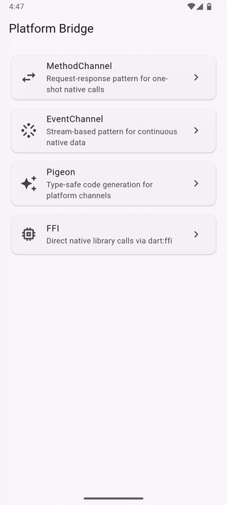

# Flutter Platform Bridge

[](https://github.com/hendra-marihot/flutter-platform-bridge/actions/workflows/ci.yml)
[](LICENSE)

A Flutter app that walks through the four ways Dart talks to native code. MethodChannel and EventChannel are implemented against real Android APIs. Pigeon and dart:ffi are annotated concept screens. The repo shows that I understand the framework boundary itself, not only which package to install.



## What's here

| Pattern | Screen | Status | Use it for |
|---------|--------|--------|------------|
| MethodChannel | Battery level and state | Working | One-shot native calls: battery, clipboard, device info |
| EventChannel | Live accelerometer | Working | Continuous native streams: sensors, location, Bluetooth |
| Pigeon | Concept screen | Display only | Many channel calls. Removes stringly-typed boilerplate |
| dart:ffi | Concept screen | Display only | C and C++ libraries: image processing, crypto, ML inference |

The two working demos call Android's `BatteryManager` and `SensorManager`. The two concept screens show annotated code and tradeoff tables.

## Decisions

### No external packages

The only dependencies are `flutter`, `flutter_test` and `flutter_lints`. Every line of channel code, serialization and lifecycle handling is in the repo, so there is no package hiding the mechanism.

### Two working, two conceptual

MethodChannel and EventChannel are what a Flutter developer writes by hand, so they are implemented end to end. Pigeon and FFI need code generation and C compilation. The interesting question with them is when to adopt them, not how to run the generator, so they are explained instead.

### A `late final` stream

`SensorStream.accelerometerEvents` is a `late final` field, not a getter. `EventChannel.receiveBroadcastStream()` creates a new native listener each time it is called. A getter would leak sensor listeners on every access. The field gives one native subscription per `SensorStream`, with `onListen` and `onCancel` firing on each Dart subscribe and cancel. I found this bug while building the demo.

### `mounted` after every await

`MethodChannelScreen._fetchBatteryLevel()` checks `mounted` after the service call, in both catch blocks and in `finally`. Every async gap in a `StatefulWidget` is a possible `setState` after dispose.

## Architecture

```
┌─────────────────────────────────────────────────────────────────┐
│  Flutter (Dart)                                                 │
│                                                                 │
│  MethodChannelScreen ──► BatteryService ──► MethodChannel ──────┤──►
│                          (typed async)      (binary codec)      │
│                                                                 │   Native (Kotlin)
│  EventChannelScreen ──► SensorStream ──► EventChannel ──────────┤──►
│                         (late final       (broadcast stream)    │
│                          cached stream)                         │
│                                                                 │   MainActivity.kt
│  PigeonScreen ─────── display-only ─────────────────────────────┤   ├─ MethodCallHandler
│  FfiScreen ────────── display-only ─────────────────────────────┤   │  getBatteryLevel()
└─────────────────────────────────────────────────────────────────┘   │  getBatteryState()
                                                                      │  getBatteryInfo()
                                                                      │
                                                                      └─ AccelerometerStreamHandler
                                                                         onListen → registerListener
                                                                         onCancel → unregisterListener
```

Each pattern lives in its own directory under `lib/`. `BatteryService` and `SensorStream` wrap the raw channels and expose typed Dart APIs. The UI never touches `MethodChannel` or `EventChannel` directly.

`MainActivity.kt` registers both handlers in `configureFlutterEngine`. The accelerometer handler registers the sensor listener in `onListen`, unregisters it in `onCancel`, and clears references to avoid leaks.

## How the patterns compare

| | MethodChannel | EventChannel | Pigeon | dart:ffi |
|---|---|---|---|---|
| **Data flow** | Dart → Native → Dart | Native → Dart (stream) | Dart ↔ Native | Dart ↔ Native |
| **Type safety** | Runtime (Map) | Runtime (Map) | Compile time (generated) | Compile time (typedefs) |
| **Serialization** | StandardMethodCodec | StandardMethodCodec | StandardMethodCodec | None, direct ABI |
| **Boilerplate** | Manual per method | Manual handler | Generated | Manual typedefs |
| **Errors** | PlatformException | Stream onError | Typed exceptions | Native crashes |
| **Best for** | One-shot calls | Continuous events | More than a few methods | C and C++ bindings |

## Tests

39 tests across 6 files. The native side does not exist in `flutter test`, so the strategy splits at the boundary.

- **Fully tested:** `BatteryService` and `MethodChannelScreen`. The channel is intercepted with `TestDefaultBinaryMessengerBinding.instance.defaultBinaryMessenger.setMockMethodCallHandler`. Tests cover the happy path, null fallbacks, `PlatformException` propagation, loading and error states.
- **Partly tested:** `SensorStream` and `EventChannelScreen`. Tests verify stream caching with `identical(stream1, stream2)`, event parsing, and widget behavior for data, error and dispose. The real sensor path needs hardware.

CI gates coverage at 60%, which is fair given two display-only screens and hardware-bound callbacks.

## Not included

- **iOS handlers.** The Dart side is platform-neutral. iOS would need Swift with `CMMotionManager` and `UIDevice`. Same channel names, no Dart changes.
- **Working Pigeon or FFI.** See above.
- **State management, DI, networking.** Covered in the other repos.

## Project structure

```
lib/
├── main.dart                       Entry point
├── app.dart                        MaterialApp, Material 3 theming
├── home_screen.dart                Navigation hub (4 demo cards)
├── method_channel/
│   ├── battery_service.dart        Typed MethodChannel wrapper
│   └── method_channel_screen.dart  Battery demo UI + state
├── event_channel/
│   ├── sensor_stream.dart          Typed EventChannel wrapper (late final cache)
│   └── event_channel_screen.dart   Live accelerometer UI + start/stop lifecycle
├── pigeon/
│   └── pigeon_screen.dart          Code walkthrough + comparison table
└── ffi/
    └── ffi_screen.dart             Code walkthrough + memory model diagram

android/app/src/main/kotlin/.../
└── MainActivity.kt                 BatteryManager + SensorManager handlers

test/                               39 tests across 6 files, mirroring lib/
```

## Run it

Needs Dart 3.8+ and an Android device or emulator. The channel demos make real native calls.

```bash
flutter pub get
flutter run        # needs a device
flutter test       # no device needed
flutter analyze
```

## CI

GitHub Actions runs on every push and PR to `main`: `flutter analyze --fatal-infos`, `dart format --set-exit-if-changed`, tests with coverage, and a 60% coverage gate. The gate parses the lcov file with `awk`, so the pipeline does not need the `lcov` CLI.

## Next steps

1. **iOS parity.** Swift handlers for battery and accelerometer.
2. **Working Pigeon.** Run the generator end to end and replace the raw MethodChannel calls. This is the upgrade a production codebase would make first.
3. **Native to Dart calls.** An example where native code starts the call, such as a push notification or deep link.

## Related repositories

Each repo in this set covers one area of mobile engineering.

| Repository | Focus |
|---|---|
| [compose-newsreader](https://github.com/hendra-marihot/compose-newsreader) | Multi-module Android, Hilt, Room, offline-first |
| [android-design-system](https://github.com/hendra-marihot/android-design-system) | Compose component library, design tokens |
| [compose-performance-lab](https://github.com/hendra-marihot/compose-performance-lab) | Compose performance anti-patterns and fixes |
| [kmp-currency-converter](https://github.com/hendra-marihot/kmp-currency-converter) | Kotlin Multiplatform, shared business logic |
| [flutter-expense-tracker](https://github.com/hendra-marihot/flutter-expense-tracker) | Clean Architecture, Riverpod, Drift, Material 3 |
| [flutter-ui-toolkit](https://github.com/hendra-marihot/flutter-ui-toolkit) | Reusable widgets, shimmer, adaptive layouts |
| **flutter-platform-bridge** (this repo) | Platform channels, native interop |
| [mobile-ci-cd-templates](https://github.com/hendra-marihot/mobile-ci-cd-templates) | CI/CD, release automation |

## License

Copyright 2026 Hendra Marihot. Licensed under the [Apache License 2.0](LICENSE).
